# wallet-go-postgres 實作計畫

> 本文件是**規劃階段**的產物：記錄需求怎麼來、做了哪些決策（包含被推翻的）、要怎麼實作與測試。
> **它不含任何程式碼。** 需求的逐條抄錄與編號在 [`plan.md`](./plan.md)；系統的權威描述會是 `wallet/spec/`（RealSpec），
> 兩者若有出入，以 `spec/` 為準。
>
> 測試框架是 [RealSpec](https://github.com/shichengyi/RealSpec)（本機 `/Users/shichengyi/private/github/RealSpec`）：
> 真相的單位是 `spec/` 目錄，執法的單位是 `realspec validate`，證明的單位是可執行的 scenario。
>
> 本計畫在規劃期間換過三次資料模型（記憶體 map → 單表餘額 → inbox＋分類帳），
> 並在「退款先到怎麼辦」這件事上推翻了一個擱置機制。過程保留在第 3 節。

---

## 0. 目錄

1. 規劃階段 Prompt 紀錄
2. 決策紀錄
3. 架構演進
4. 系統架構
5. 流程圖
6. Spec 產物清單
7. Step registry 的設計
8. 功能需求（FR）
9. 非功能需求（NFR）
10. 實作計畫（25 分鐘怎麼切）
11. 測試計畫
12. CI 計畫
13. 風險與緩解
14. 待確認事項
15. 驗收標準

---

## 1. 規劃階段 Prompt 紀錄

原文照錄，依時間順序。

### 1.1 第一則需求

> 將'/Users/shichengyi/private/interview/untrusted-ai-coding-interview-wallet'
> readme 的需求寫入 plan.md
> 流程圖架構圖時序圖等等任何需要用到的mermaid圖 與規劃階段prompt寫入全新plan-*.md(不得包含程式碼)
> 測試框架使用 /Users/shichengyi/private/github/RealSpec

### 1.2 第二則：先產出 spec/

> 開一個subagent 先把spec/寫出來
> spec.md不用寫 只專注在bdd跟format

### 1.3 第三則：更正

> 更正 開多個
> 然後openapi也要有

於是 `spec/` 的產出改成四個平行 agent：registry ＋ 兩份 OpenAPI 一人、十個 feature 檔分三組。
**封閉詞彙必須先定下來**才能平行——三組 feature 作者拿到的是同一份逐字的 step 清單（第 7 節），
因為 feature 是用 registry 的句子組裝的，不是用自己的話寫的。

### 1.4 規劃期間做的事實調查

| 來源 | 讀出來的東西 |
|------|------------|
| `README.md` | 必做需求、交付物、限制（見 `plan.md` 第 5–7 節） |
| `services/payment-provider/provider.py`（182 行，逐行讀） | 14 條題目沒明寫的隱含需求（`plan.md` 第 8 節）：重試序列 `[0,1,2,4,8,16]`、`DUPLICATE_RATE` 預設 0.3、`DELIVERY_TIMEOUT` 5 秒、每次投遞重算簽章時間戳、退款事件的 `credits` 仍是正數、沒有查單 API、6 次失敗後放棄 |
| `.github/PULL_REQUEST_TEMPLATE.md` | 交付欄位（R-24） |
| RealSpec `README.md` | validator 的機制表、registry 的規則、「什麼時候可以新增 step」 |
| RealSpec `examples/minimart-go-nuxt` | Go + godog + testcontainers 的 harness 形狀、基礎 step 的語意 |
| RealSpec `examples/paygate-rust-nuxt` | 同為金流域的先例：對手方控制 step、`exactly N callbacks were acknowledged` 的分工、容器生命週期原則、plan 文件的體例 |

---

## 2. 決策紀錄

| # | 決策 | 理由 | 來源 |
|---|------|------|------|
| **D1** | Go ＋ 標準庫 HTTP ＋ `pgx` | RealSpec 已經有 Go 的 godog＋testcontainers harness 可以抄（minimart）；啟動快、整數運算明確、25 分鐘內編譯得完 | 設計 |
| **D2** | PostgreSQL，不是記憶體 | 幂等性與併發正確性都是**對持久化的主張**；而且 RealSpec 的斷言詞彙是 SQL，選記憶體就等於放棄讓「什麼都沒發生」被第三方查核 | 設計 |
| **D3** | credits 是 `bigint` 整數，1 cent = 1 credit，全程不出現浮點 | 錢不能用浮點；題目的 `amount_cents` 本來就是整數 | README |
| **D4** | 狀態是 `wallets.balance` 一欄，但每次變動都寫一筆 append-only 的 `wallet_entries`，兩者**同交易** | 餘額欄位給 O(1) 讀與單一條件更新；分類帳回答「為什麼是這個數字」，也讓「被拒絕時什麼都沒發生」變成「0 列」 | 設計 |
| **D5** | **去重鍵是事件 id，不是付款 id**；`webhook_events` 以事件 id 為主鍵，與分錄同交易寫入（`outcome` 只有 `applied` 與 `ignored`，理由見 6.2） | 同一筆付款會發出 succeeded 與 refunded 兩個事件，兩者的付款 id 相同。以付款 id 去重會把退款吃掉 | `plan.md` I-01 |
| **D6** | **2xx 在 commit 之後才回**；拒絕、當掉、程序不在，一律讓 provider 重送 | at-least-once 是我們唯一的復原機制。回了 2xx 卻沒寫入，事件永遠不會再來 | I-03 |
| **D7** | 簽章對 **raw bytes** 驗、constant-time 比對、時間戳容忍窗 300 秒 | 簽的是 `"<t>." + 原始 body`，重新序列化就對不上（I-08）；每次投遞重算 `t`（I-09），而重試窗最長 31 秒 ≪ 300 秒，所以容忍窗擋得住離線重放又不會誤殺重試 | I-08、I-09 |
| **D8** | **退款允許把餘額變成負的**；分錄是可交換的，退款事件先到就直接記負數 | 錢真的退回去了，帳不能說謊。負餘額是「這個 user 欠 credits」的誠實表示，而且讓退款與入帳的順序無關 | U-02、U-10 |
| **D9** | ~~退款先到就擱置，等入帳事件到了再一起套用~~ → **推翻** | 需要一張依賴表、一個 worker，和一個「入帳事件永遠不來」的故事；交換律免費給出同樣的最終餘額 | 設計 |
| **D10** | 餘額可以是負的，所以**不能**用 `CHECK (balance >= 0)`；「不准超扣」由 spend 的**單一條件更新**保證 | 規則只能有一個家。CHECK 會同時擋掉合法的退款沖回 | 設計 |
| **D11** | spend 是一次帶條件的更新並回傳新餘額，不做先讀再寫 | 先讀再寫就是 check-then-act，四個同時扣款會超扣。這條規則由一個併發 scenario 守著 | 設計 |
| **D12** | spend 支援選用的 `Idempotency-Key`；同鍵同 body 回放、同鍵不同 body 拒絕 | 扣款是客戶端在不可靠網路上發起的寫入，唯一安全的重試是帶鍵的重試 | U-03 |
| **D13** | 餘額不足回 `422 INSUFFICIENT_BALANCE`，驗證失敗回 `400 INVALID_AMOUNT`，錯誤碼是機器可讀的穩定字串 | 題目只說 4xx；把「你的請求有問題」與「你的錢不夠」分開，客戶端才能自動處理 | U-04、B-09 |
| **D14** | 錢包**隱式存在**：查從未付款過的 user 回 `200` ＋ `balance: 0`，而且不建立任何列 | credits 可能為一個我們從沒見過的 user 抵達；`404` 會逼客戶端處理一個不存在的錯誤 | U-01 |
| **D15** | 未知的事件型別 → `200` ＋ inbox 記 `ignored` ＋ 0 筆分錄 | 事件型別會長出來。把未知型別當失敗，provider 會永遠重送同一封 | I-14 |
| **D16** | 不做認證；webhook 的身分由簽章給，另兩支明列為非目標 | 題目沒有這個需求，硬加會佔掉 25 分鐘裡的時間，而且 25 分鐘做出來的認證不會比沒有更安全 | U-06 |
| **D17** | 對帳是一次性的 worker 指令（reconciler），不是排程 | provider 6 次嘗試用完就放棄（I-10），而且沒有查單 API，只有 `GET /events`（I-11）。對帳是必要的；排程不是這個面試的範圍 | B-06 |
| **D18** | 測試用**題目真的那個 provider**，不自己寫 mock | R-30 不准改 `services/`，但它的行為由環境變數參數化——**調環境變數不是改程式碼**。用真的對手方，簽章是否正確才是被對方驗證的，而不是被我們自己的 mock 驗證的 | R-30、I-07 |
| **D19** | 測試一律 `DUPLICATE_RATE=0`，重複投遞由 `POST /events/{id}/resend` 決定性地產生；另有一條 scenario 跑 `DUPLICATE_RATE=1` | 0.3 的機率會讓「只入帳一次」這條斷言有 70% 的時候根本沒被測到 | I-07 |
| **D20** | harness **只產生 provider 絕不會產生的東西**：無簽章、錯密鑰、簽完被竄改、過期時間戳、壞 header、壞 body、未知型別、刻意的亂序 | 正常路徑走真的 provider，所以「簽對了」是由對方簽、我們接受來證明的；feature 裡永遠不會出現雜湊值 | 設計（取自 paygate D54） |
| **D21** | **沒有 e2e surface**，CI 是兩階段而不是三階段 | RealSpec 的分界是「誰驅動 scenario」。這個系統沒有瀏覽器、沒有 CLI 產品、沒有人類驅動的介面。curl demo 是**文件**，它說的事實與 `api/*.feature` 斷言的是同一組 | 設計 |
| **D22** | `http_request` 綁 OpenAPI（`method` ＋ `path`），契約放 `spec/openapi/`，另外寫一份 provider 的契約 | 使用者更正後明確要求 openapi；綁了之後，feature 寫出契約沒定義的路徑會在驗證階段就 fail | 1.3 |
| **D23** | 封閉詞彙 19 個 step，其中 6 個是新增的 | 新增的門檻是**能力**而不是便利；每一個的理由見第 7 節 | RealSpec 規則 |
| **D24** | 容器生命週期一律交給 testcontainers，每個 scenario 一套（postgres ＋ wallet ＋ payment-provider） | 自己管生命週期正是「每個 scenario 一套獨立環境」悄悄失效的地方 | paygate 10.5 |
| **D25** | 25 分鐘內交付的是**核心服務 ＋ 一份能跑的 demo**；RealSpec 全套（harness ＋ 10 個 feature）是面試後的交付 | 誠實的時間估算：十個 feature 檔各自起三個容器，不可能在 25 分鐘內連實作一起生出來。規格可以先寫（規劃階段就寫完了），bindings 不行 | 設計 |
| **D26** | `/health` ＋ 每個回應都有 `X-Request-Id`（客戶端帶來的沿用） | demo 與 Q&A 時要能指著日誌說「這封事件發生了什麼」 | B-07 |
| **D27** | 稽核端點 `GET /wallets/{user_id}/entries` | 分類帳存在卻看不見，等於只有我自己知道它存在 | B-08 |
| **D28** | 時間一律 `timestamptz`、UTC 儲存 | 面試題沒有時區需求，但「credits 什麼時候到帳」是會被問的問題 | 設計 |

---

## 3. 架構演進

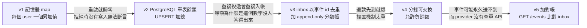

### 3.1 v1 → v2：為什麼不是記憶體

25 分鐘的題目，記憶體 map 五分鐘就寫完，而且題目明寫「any storage you like」。推翻它的不是效能，是**可斷言性**：

| 主張 | 記憶體 map 能不能證明 |
|------|---------------------|
| 餘額不足時「什麼都不改變」（R-05） | 只能用自己的 API 再查一次餘額——用待測系統證明待測系統 |
| 重複投遞只入帳一次 | 同上 |
| 重啟之後錢還在 | 不能，它就是會消失 |
| 四個同時扣款不會超扣 | 一把 mutex 可以，但沒有第三方能查核中間狀態 |

RealSpec 的斷言詞彙是 SQL（`in PostgreSQL query returns 0 rows:`），這不是巧合：**「什麼都沒發生」只能由一個不是待測系統的東西來回答**。

### 3.2 v2 → v3：去重鍵選錯會把退款吃掉

v2 用 `UPSERT` 把 credits 加到餘額上，正確性完全依賴「同一個事件只會來一次」——而 provider 明寫至少一次、預設 30% 機率重複、失敗重試六次。

第一版的去重鍵想用**付款 id**（「同一筆付款只能入帳一次」聽起來很對）。讀 `provider.py` 的 `emit()` 才發現：退款事件送的是 payment 的快照，`data.payment.id` 與入帳事件**完全相同**，只有 `status` 不同。以付款 id 去重，退款會被當成重複而被丟掉——錢退了，credits 沒收回。

去重鍵是**事件 id**。它也剛好是 provider 唯一保證唯一的東西。

### 3.3 v3 → v4：退款先到，與一個被推翻的擱置機制

事件不保證順序（README 明寫），而且兩個事件在 provider 裡各開一條 thread、各自延遲與重試——退款先到是會發生的。

第一個方案是**擱置**：退款沒有對應的入帳紀錄就存成 `pending_dependency`，等入帳事件到了再一起套用。它需要一張依賴表、一個會重掃的 worker、以及一個「入帳事件永遠不來」的故事（那筆退款要擱置到什麼時候？）。

推翻它的是一句話：**分錄是可交換的**。入帳是 `+credits`、退款是 `-credits`，兩者都以事件 id 去重，所以

| 抵達順序 | 中間餘額 | 最終餘額 |
|---------|---------|---------|
| 入帳 → 退款 | +500 | 0 |
| 退款 → 入帳 | **-500** | 0 |

唯一的代價是中間會出現負餘額。而負餘額本來就必須存在——credits 被花掉之後才退款，帳上就是負的（D8）。既然要支援它，順序就不必管了：擱置機制整個消失，換成一條 `ordering.feature` 的交換律 scenario。

### 3.4 v4 → v5：事件會永久消失

`deliver_with_retries()` 跑完 `[0,1,2,4,8,16]` 六次就 `print("gave up")`。如果我們的服務剛好在那 31 秒裡掛著，**那筆 credits 永遠不會到帳，而且沒有任何人會再提醒我們**。

provider 沒有「查某筆付款」的 API，只有 `GET /events`（含每次投遞的嘗試紀錄）。所以對帳的形狀是固定的：列出 provider 的事件、與自己的 inbox 比對、把缺的補套用，而且必須是幂等的（它會與正常的 webhook 路徑撞到同一個事件 id）。

這也是**為什麼 inbox 不能只是一個 `seen` 的 set**：對帳需要知道「我處理過哪些事件」，而這件事必須在重啟之後還在。

---

## 4. 系統架構

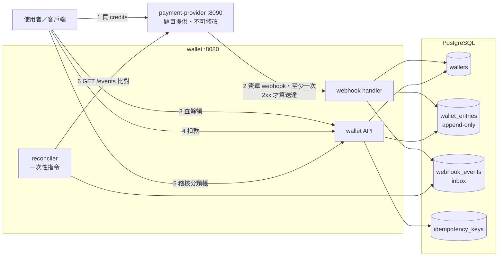

| 元件 | 責任 |
|------|------|
| webhook handler | 驗簽 → 以事件 id 去重 → 在單一交易裡寫 inbox ＋ 分錄 ＋ 餘額 → commit 之後才回 2xx |
| wallet API | 查餘額、扣款（帶條件的單次更新）、稽核分類帳、`/health` |
| reconciler | 比對 provider 的事件清單與 inbox，補套用缺的事件；幂等 |
| payment-provider | 題目提供的 mock 金流商。**不修改程式碼**，只在測試裡調它的環境變數（`WEBHOOK_URL`、`WEBHOOK_SECRET`、`DUPLICATE_RATE`） |

| 表 | 角色 |
|----|------|
| `wallets` | 餘額的快取欄位，與分錄同交易更新；可以是負的 |
| `wallet_entries` | append-only 分類帳，`credit` / `spend` / `reversal`；`balance` 永遠等於 `sum(amount)` |
| `webhook_events` | inbox，主鍵是 provider 的事件 id；`outcome` 為 `applied` / `ignored`，重複送達不會產生第二列（見 6.2） |
| `idempotency_keys` | 只服務 spend 的重試 |

---

## 5. 流程圖

### 5.1 一筆 credits 從購買到花掉

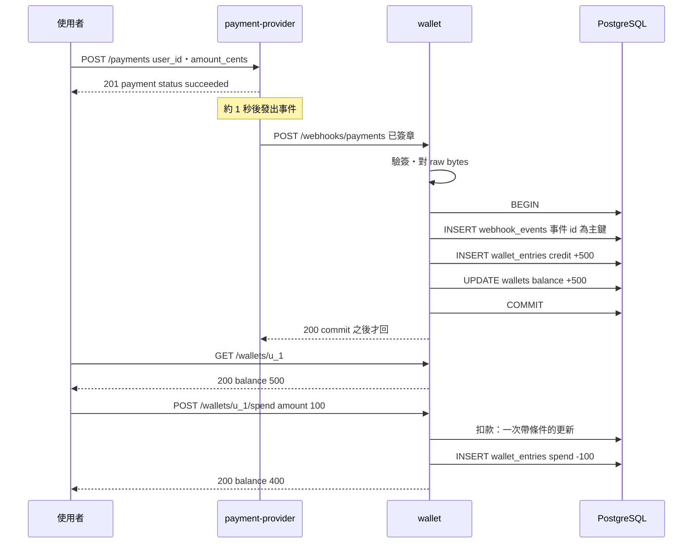

### 5.2 重複投遞：至少一次送達的真實形狀

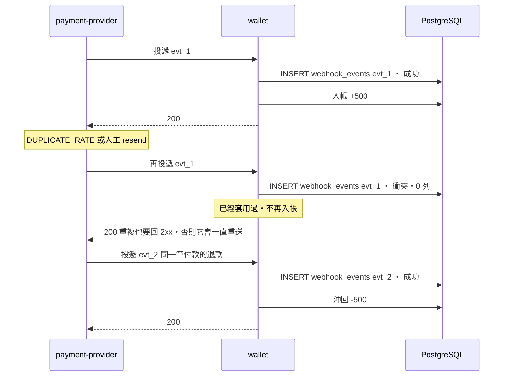

### 5.3 webhook handler 的決策

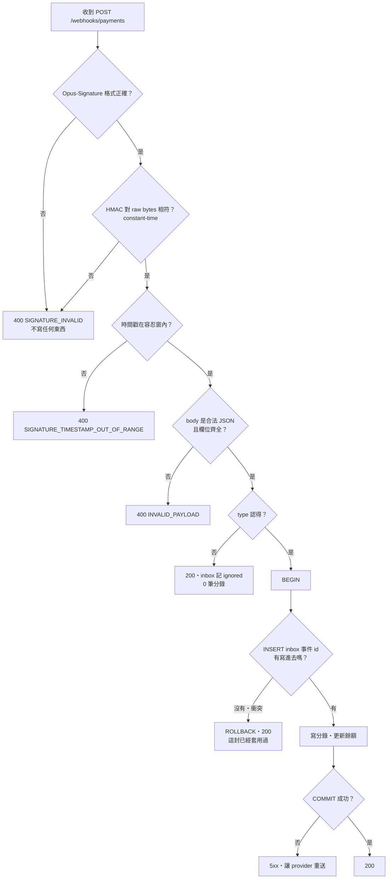

### 5.4 inbox 裡一封事件的狀態

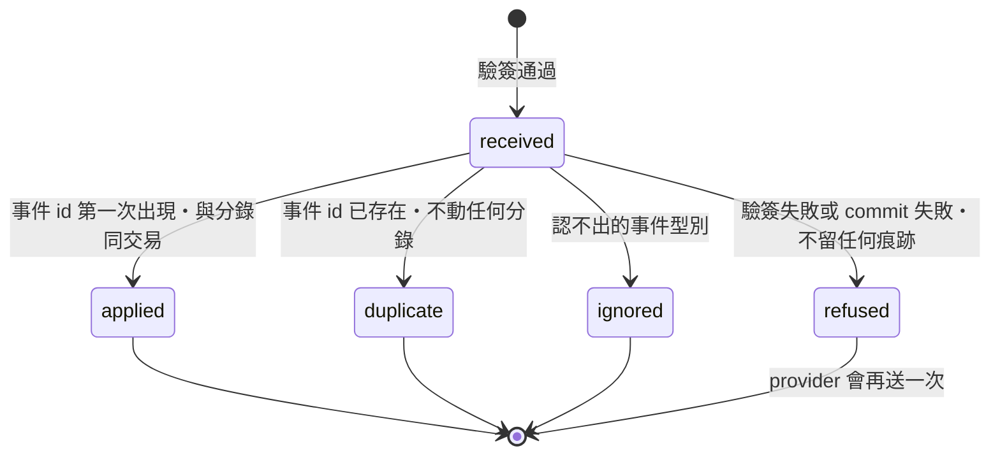

`refused` 不是 inbox 裡的一列，是**沒有那一列**——這正是 `in PostgreSQL query returns 0 rows:` 要斷言的東西。

### 5.5 一次狀態變更寫了什麼

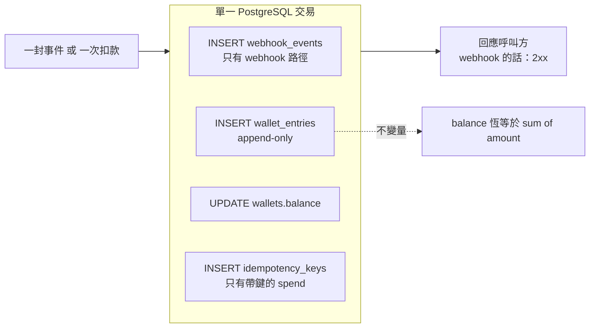

### 5.6 扣款的併發

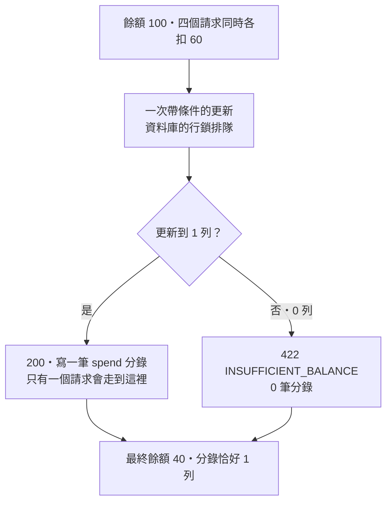

先讀再寫的版本會讓四個請求都看到 100、都通過檢查、都扣款。**守住這條規則的是一個併發 scenario，不是程式碼裡的註解。**

### 5.7 退款與順序無關

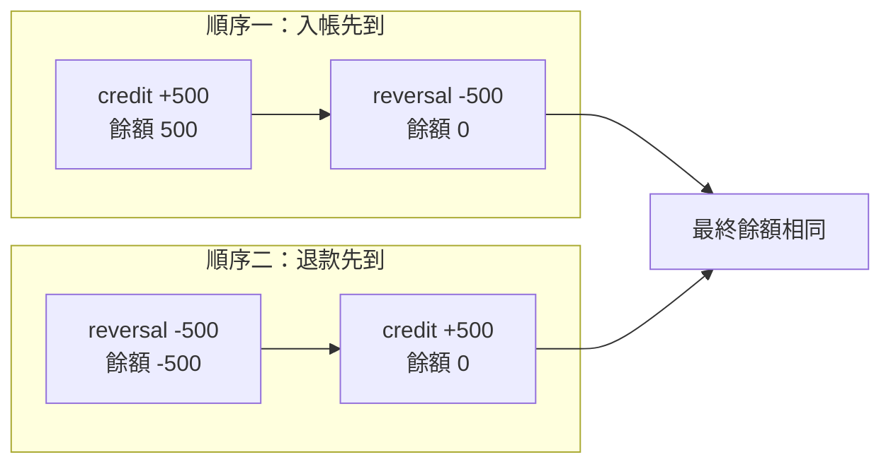

負餘額期間 spend 一律被拒；這條規則讓「允許負餘額」不會變成「可以憑空花錢」。

### 5.8 故障模型

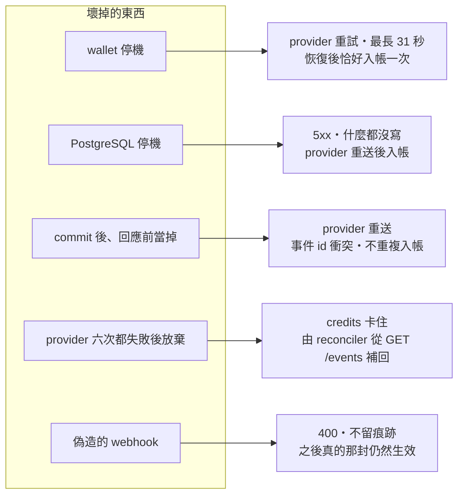

### 5.9 對帳

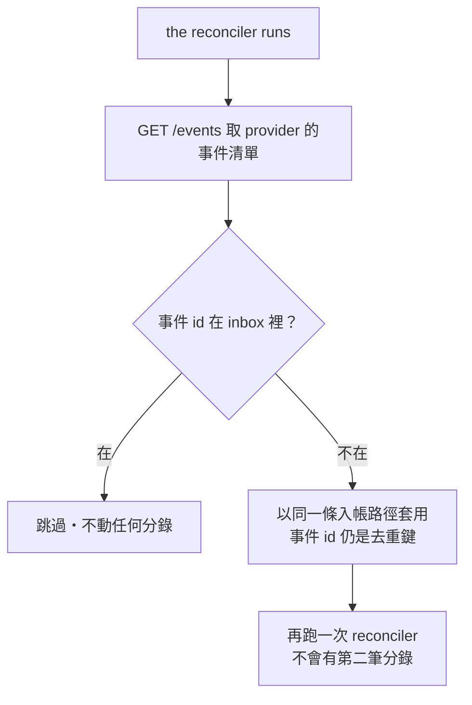

對帳只信 provider 的事件清單，所以**被拒絕的偽造事件不會被對帳救活**——它從來不在那張清單上。

### 5.10 每個 scenario 的測試 stack

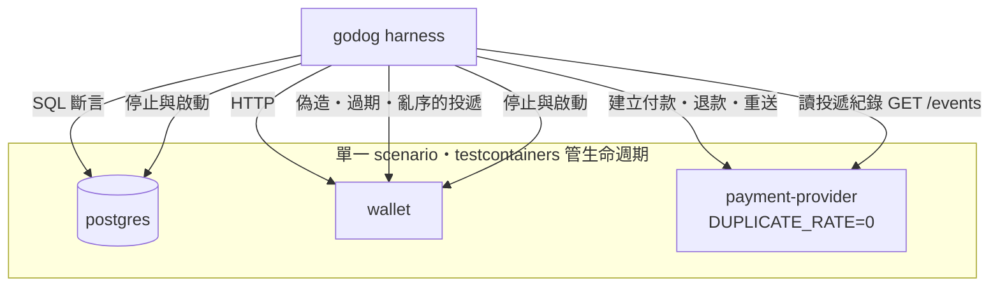

### 5.11 CI

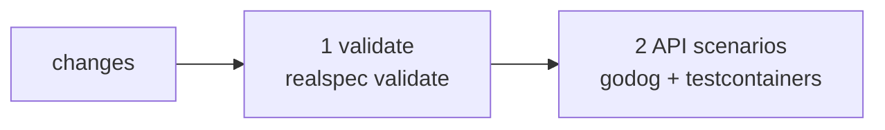

只有兩階段：沒有 e2e surface（D21）。validate 先跑，因為它是唯一不花錢的一關——一個用了不存在的 step 的 feature 不該進到容器裡。

---

## 6. Spec 產物清單

`spec/` 放在 `wallet/spec/`（R-31：所有自己的東西都在 `wallet/`）。

| 檔案 | 內容 | 狀態 |
|------|------|------|
| `spec/openapi/openapi.yaml` | wallet 自己的契約：`POST /webhooks/payments`、`GET /wallets/{user_id}`、`POST /wallets/{user_id}/spend`、`GET /wallets/{user_id}/entries`、`GET /health`。穩定錯誤碼、金額一律 `int64` | 本次產出 |
| `spec/openapi/payment-provider.yaml` | **對手方**的契約：`POST /payments`、`POST /payments/{id}/refund`、`POST /events/{id}/resend`、`GET /events`、`GET /health`，以及 webhook callback 的 payload 與 `Opus-Signature` header | 本次產出 |
| `spec/bdd/format.yml` | step registry，19 個 step（13 沿用、6 新增） | 本次產出 |
| `spec/bdd/api/*.feature` | 10 個檔案：`wallets`、`spend`、`observability`、`credit`、`dedupe`、`signature`、`refund`、`ordering`、`resilience`、`reconcile` | 本次產出 |
| `spec/bdd/e2e/` | **刻意不存在**（D21：沒有人類驅動的介面） | — |
| `spec/spec.md` | 架構與決策的權威描述 | **尚未撰寫**（使用者指示本輪只做 bdd 與 openapi）。在它存在之前，本計畫第 2–5 節是架構的唯一文字來源 |

產出方式：四個平行的 agent——registry ＋ 兩份 OpenAPI 一人，十個 feature 檔分三組（同步 API／webhook 入帳／退款與故障）。
**封閉詞彙先定、再平行**：三組 feature 作者拿到同一份逐字的 step 清單，否則十個檔案會長出十套方言。

### 6.1 Scenario 數量

| Feature | Scenario | 展開後執行次數 |
|---------|---------:|--------------:|
| `spend` | 14 | 16 |
| `credit` | 8 | 10 |
| `signature` | 8 | 8 |
| `wallets` | 7 | 7 |
| `observability` | 7 | 7 |
| `dedupe` | 6 | 10 |
| `reconcile` | 6 | 6 |
| `ordering` | 5 | 8 |
| `refund` | 5 | 5 |
| `resilience` | 6 | 6 |
| **合計** | **72** | **83** |

展開後比 scenario 多出來的 11 次全部來自競態與交換律的 Scenario Outline（各跑 3 次）與入帳金額的 outline。

**實際執行結果：83／83 次全部通過、707／707 個 step 通過、0 失敗**（每個 tag 各自執行，報告合併於 `reports/bdd-all.html`；合併而非重跑，因為 tag 與 feature 檔是一對一，聯集就是整套、每條剛好一次）。`@dedupe`、`@ordering`、`@resilience`、`@reconcile` 另外各自連跑兩次都綠。

其中 7 條標了 **`@minimum`**：它們就是 README 表格的那三支端點（webhook 入帳 2 條、查餘額 2 條、扣款 3 條，含「餘額不足什麼都沒發生」）。實作的第一個里程碑是 `BDD_TAGS=@minimum` 全綠，其餘 tag 在那之後。

### 6.2 寫 feature 時發現的三個規格缺陷

這三個是 feature 作者在**寫斷言時**撞到的，不是我在規劃時想到的——也正是先寫規格的價值所在。

| 缺陷 | 原本的設計 | 改成 |
|------|-----------|------|
| `webhook_events.outcome = 'duplicate'` **根本到不了** | 我把 `duplicate` 放進了 `outcome` 的列舉 | 事件 id 是主鍵，重複送達**不可能**插入第二列，所以沒有任何一列會是 `duplicate`。`outcome` 只有 `applied` 與 `ignored`；「重複送達沒有改變任何東西」由**分錄列數**與**provider 的投遞紀錄**證明，而不是由一個永遠寫不進去的欄位證明 |
| 「provider 放棄投遞」沒辦法等 | `background work has settled` 只能等成功 | 這件事只能用凍結 provider 來排演，於是 `service "payment-provider" is stopped` 必須是**暫停**（process 掛起、記憶體裡的事件清單留著），不是殺掉——否則對帳沒有東西可讀，`reconcile.feature` 整份寫不出來。這個語意現在寫在 registry 與該檔檔頭 |
| 「對 provider 的呼叫預期會失敗」說不出來 | 想寫「第二次退款 provider 回 409」 | 現有詞彙裡沒有任何 step 承載對手方的錯誤回應。那條 scenario 被**刪掉**，不是改寫成一個假裝通過的版本。要它回來就得新增一個 step，而那是一句新的話，必須單獨評估（見第 14 節） |

第四個缺陷是在 registry 與 OpenAPI 都寫好之後才看出來的：**沒有任何 scenario 斷言 5xx**。`service "postgres" is stopped` 這個 step 存在的那條規則——「寫不進去就不能回 2xx，否則 provider 會把事件從清單上劃掉，那是這系統裡唯一無法復原的失敗」——當時只存在於契約裡。已補上 `resilience.feature` 的「A webhook that cannot be stored is refused rather than acknowledged」：`503` ＋ `STORAGE_UNAVAILABLE`，恢復後同一封事件再送一次恰好入帳一次。

另外兩件事被記錄為刻意的妥協：
- `resilience.feature` 的「先 refused 後 accepted」是用 `resend` 排演的，不是靠 provider 的自動重試——**落在停機視窗裡的自動嘗試次數不是決定性的**，用它斷言就是寫一條會偶發失敗的測試。
- `X-Request-Id` 的格式只能斷言「含有 `-`」，因為封閉詞彙裡沒有正規表達式的 header 斷言。為一條斷言新增一個 step 不划算（第 14 節第 4 項）。

### 6.3 實作時發現的四個契約缺陷

寫 feature 抓到三個（6.2），寫實作又抓到四個。這些都不是「程式碼沒照規格做」，而是**規格自己說不通**。

| 缺陷 | 改成 |
|------|------|
| 兩支讀取端點（`GET /wallets/{user_id}`、`/entries`）只宣告 `200`，但 registry 裡明明有 `service "postgres" is stopped` | 兩支都補上 `503 STORAGE_UNAVAILABLE`，並寫明：讀取沒有快取的答案可以給，也不會自己編一個；`/health` 仍然活著，好讓維運分辨「服務不在」與「儲存不在」 |
| `SpendRequest` 宣告 `additionalProperties: false`，但實作刻意不拒絕未知欄位，而且沒有任何 scenario 送過未知欄位 | 契約改成**忽略**未知欄位並寫下理由：拒絕會讓一個送了新版欄位的客戶端吃到 `400`，那比忽略更糟；`amount` 是唯一被讀的欄位，它的型別被嚴格檢查 |
| `Idempotency-Key` 有 `maxLength: 255`，卻沒有對應的錯誤碼，也沒有 scenario 斷言它 | **拿掉長度上限**。一條規則需要一個錯誤碼與一條斷言它的 scenario；沒有需求就不該有規則——這比發明一個 `IDEMPOTENCY_KEY_INVALID` 誠實 |
| `idempotency_keys.response_body` 是 `jsonb`，存的是**值**而不是 bytes：寫進去的 `{"user_id":…,"balance":…}` 讀回來可能變成 `{"balance":…,"user_id":…}` | 回放改成用產生原回應的同一個 marshaller 重新 render。「byte-identical 的回放」是**重新產生**的性質，不是**儲存**的性質；而回放的數字仍然是第一次呼叫的餘額，不是重算的 |

另外一項實作層的硬化值得記下來：`ingest.Apply` 自己設了 **4 秒**上限，壓在 provider 的 `DELIVERY_TIMEOUT`（5 秒）之下。一個卡住的資料庫因此會讓 provider **收到** `503`，而不是讓它等到逾時——前者是一次明確的失敗並立刻進入退避，後者浪費掉整整五秒。而「取消一個其實已經 commit 成功的交易」是安全的：重送會被認成重複，這與「commit 之後、回應之前當掉」靠的是同一個保證。

> 驗證方式：`realspec validate --format wallet/spec/bdd/format.yml wallet/spec/bdd/api/*.feature`。
> 驗證結果以執行當次的輸出為準，本文件不代為宣告。

---

## 7. Step registry 的設計

### 7.1 沿用 minimart 的 13 個，語意不變

`run migration`、`in PostgreSQL:`、`in PostgreSQL query returns N rows:`、`<METHOD> <path>:`、`these things happen at one instant:`、`response status is`、`exactly N responses are`、`response body contains:`、`response body does not contain`、`response header ... contains`、`save response body field ... as ...`、`background work has settled`、`service "..." is (stopped|started)`。

這些 step 的行為在 minimart 與 paygate 已經被 300 多次使用settle 過；拿它們來寫這個題目的規格，等於**句子的意思在這個專案開始之前就已經固定**。

### 7.2 新增的 6 個，每一個都是能力

| Step | 動作 | 為什麼不能用現有 step 組合出來 |
|------|------|------------------------------|
| `payment provider creates a payment as "<var>":` | 向題目的 provider 建立付款，並把它的 payment id 存成 context 變數 | `<METHOD> <path>:` 打的是**我們自己的**服務；provider 是對手方，而且入帳的起點只能是它 |
| `payment provider refunds payment "<id>"` | 讓 provider 發出退款事件 | 同上；而且退款事件只有它能簽 |
| `payment provider redelivers each event N times` | 決定性地製造重複投遞 | `DUPLICATE_RATE` 是機率；0.3 的機率等於 70% 的時候「只入帳一次」根本沒被測到 |
| `exactly N webhook deliveries were (accepted\|refused)` | 讀 **provider 自己的**投遞紀錄 | 自己的表只能說「我寫了什麼」，不能說「對方被呼叫幾次、對方認為成功幾次」。`2xx` 才是 provider 眼中的送達 |
| `a webhook is delivered by the harness[, <變體>]:` | 由 harness 產生 provider **絕不會產生**的投遞：無簽章、錯密鑰、簽完被竄改、過期時間戳、壞 header、壞 body，以及刻意的亂序 | feature 不可能自己算 HMAC；而真的 provider 無法被要求「先送退款再送入帳」（兩個事件各開一條 thread）。這條分工是刻意的：**正常路徑走真的 provider，harness 只做對手方做不到的壞事** |
| `the reconciler runs` | 一次性的對帳指令 | 它不是等待、不是 HTTP 呼叫，沒有任何現有 step 能表達「跑一次維運程序」 |

### 7.3 併發只有一種說法

`these things happen at one instant:` 的 docstring 是一個 array，每個元素**要嘛**是帶自己 `method`／`path` 的 envelope（本服務的呼叫者），**要嘛**是 `{"step": "..."}` 指名本 registry 裡宣告了 `When` 且自己沒有 docstring 的 step。

後者不是前者的另一種寫法，而是**唯一**能讓「不是呼叫者的參與者」參與競態的方式——對帳程序跑一次、provider 重送一次，都不是一個 HTTP 請求。被指名的 step 自己不能有 docstring，所以這個 step 無法指名自己，封閉性因此成立。

### 7.4 斷言的分工

- **PostgreSQL 立即查**（`wallets`、`wallet_entries`、`webhook_events`、`idempotency_keys`）：同交易寫入，回應送出時就為真。
- **對外的事實**（provider 投遞了幾次、認可了幾次）一律從對手方的紀錄讀，不從自己的表推論。
- **非同步的事**（webhook 投遞、對帳）一律在 `background work has settled` 之後才斷言。registry 裡沒有「等 N 秒」這種句子，所以也寫不出來。

### 7.5 「什麼都沒發生」是這個題目的核心斷言

README 唯一明寫的負面後置條件是 R-05：餘額不足要回 4xx **而且不改變任何東西**。只斷言狀態碼的測試會在「先扣款再拒絕」時照樣通過；會在「扣了款但回 422」時照樣通過。

所以本專案每一條「被拒絕」的 scenario 都必須同時附上 `in PostgreSQL query returns 0 rows:`。這不是風格，這是**選擇 RealSpec 的全部理由**。

---

## 8. 功能需求（FR）

| Id | 需求 | 對應 `plan.md` | 驗證 |
|----|------|---------------|------|
| FR-01 | 付款成功的 webhook 把 `credits` 入帳到該 user 的錢包，錢包不存在時即時建立 | R-01、R-02 | `api/credit.feature` |
| FR-02 | 2xx 在交易 commit 之後才回；任何失敗回非 2xx 讓 provider 重送 | I-03 | `api/credit.feature`、`api/resilience.feature` |
| FR-03 | 以**事件 id** 去重：同一事件送幾次都只入帳一次，重複送達仍回 2xx | I-01、I-02 | `api/dedupe.feature` |
| FR-04 | 同一筆付款的入帳與退款是兩個事件，兩者都必須生效 | I-01 | `api/dedupe.feature`、`api/refund.feature` |
| FR-05 | 簽章驗證：對 raw bytes、constant-time、時間戳容忍窗；六種無效投遞各自被拒且不留痕跡 | B-02、I-08、I-09 | `api/signature.feature` |
| FR-06 | 未知事件型別：`200` ＋ inbox 記 `ignored` ＋ 0 筆分錄 | I-14 | `api/credit.feature` |
| FR-07 | 查餘額：已知 user 回實際餘額；未知 user 回 0 且不建列；user 之間互不影響 | R-03、U-01 | `api/wallets.feature` |
| FR-08 | 扣款成功：回新餘額、寫一筆負向分錄、餘額同步 | R-04 | `api/spend.feature` |
| FR-09 | 餘額不足：`422 INSUFFICIENT_BALANCE`，**0 筆分錄、餘額不變** | R-05 | `api/spend.feature` |
| FR-10 | `amount` 驗證：`0`、負數、浮點、字串、缺欄位一律 `400 INVALID_AMOUNT` 且什麼都不寫 | U-05 | `api/spend.feature` |
| FR-11 | 併發扣款不超扣：餘額 100、四個同時各扣 60 → 1 成 3 敗、餘額 40、分錄 1 列 | B-05 | `api/spend.feature` |
| FR-12 | 扣款的 `Idempotency-Key`：同鍵同 body 回放、同鍵不同 body 拒絕、不同鍵各自生效 | U-03、B-04 | `api/spend.feature` |
| FR-13 | 退款以 `reversal` 負向分錄套用；credits 已被花掉時**允許餘額為負**，負餘額時扣款被拒 | U-02 | `api/refund.feature` |
| FR-14 | 事件順序無關：退款先到也正確，最終餘額與順序無關 | I-05、U-10 | `api/ordering.feature` |
| FR-15 | 故障：服務停機、DB 停機、commit 後當掉，恢復後都恰好入帳一次；餘額跨重啟存在 | I-03、U-07 | `api/resilience.feature` |
| FR-16 | 對帳：provider 放棄投遞的事件由 reconciler 從 `GET /events` 補回，且幂等 | B-06、I-10、I-11 | `api/reconcile.feature` |
| FR-17 | 稽核分類帳端點：列出 `kind`、`amount`、`payment_id`、`event_id`，最舊在前 | B-08 | `api/observability.feature` |
| FR-18 | `/health`；每個回應都有 `X-Request-Id`，客戶端帶來的會沿用；回應永不洩漏簽章密鑰 | B-07 | `api/observability.feature` |

---

## 9. 非功能需求（NFR）

| Id | 需求 | 怎麼被守住 |
|----|------|-----------|
| NFR-01 | 入帳是 exactly-once（在至少一次送達之上） | inbox 的主鍵 ＋ 與分錄同交易 |
| NFR-02 | 2xx 代表「已經入帳」，不代表「我收到了」 | ack-after-commit；由停 DB 的 scenario 證明 |
| NFR-03 | 扣款永遠不能讓餘額變負 | 單一條件更新；由併發 scenario 證明 |
| NFR-04 | 退款可以讓餘額變負，而且那是正確的 | 不設 `balance >= 0` 的 CHECK；由退款 scenario 證明 |
| NFR-05 | `balance` 恆等於 `sum(wallet_entries.amount)` | 同交易寫入；由不變量 scenario 直接查 |
| NFR-06 | 金額全程整數，不出現浮點 | 契約與 schema 都是 `int64`；`12.5` 被拒有專屬 scenario |
| NFR-07 | 簽章比對是 constant-time，且對 raw bytes | 實作約束；六種無效投遞的 scenario 守住外在行為 |
| NFR-08 | 簽章時間戳容忍窗 300 秒，擋離線重放但不誤殺 31 秒的重試窗 | 過期投遞的 scenario |
| NFR-09 | webhook 處理必須在 5 秒內完成 | 單一交易、無外呼；provider 的 `DELIVERY_TIMEOUT` 是 5 秒 |
| NFR-10 | 餘額與分類帳跨重啟存在 | PostgreSQL；由重啟 scenario 證明 |
| NFR-11 | 沒有任何秘密會出現在回應或稽核端點 | `response body does not contain "whsec"` |
| NFR-12 | 服務監聽 `0.0.0.0:8080` | R-06；Docker 下 provider 從 `host.docker.internal` 進來 |
| NFR-13 | 每個 scenario 一套獨立容器，生命週期交給 testcontainers | D24 |
| NFR-14 | 測試不含固定秒數等待 | registry 裡沒有這種句子 |
| NFR-15 | CI 的命令與本機的命令完全相同，不重試、沒有 CI 專用 timeout | RealSpec 的規則 |
| NFR-16 | 不修改 `services/` | R-30；只調它的環境變數 |

---

## 10. 實作計畫（25 分鐘怎麼切）

### 10.1 誠實的前提

十個 feature 檔、每個 scenario 三個容器的完整 RealSpec 套件，**不可能**在 25 分鐘內連實作一起生出來。所以切分是：

| 時段 | 產物 |
|------|------|
| 面試前／規劃階段（~5 分） | `plan.md`、本計畫、`spec/`（registry ＋ openapi ＋ 10 個 feature） |
| **面試的 25 分鐘** | 可執行的服務 ＋ migration ＋ curl demo，涵蓋 FR-01 到 FR-13 |
| 面試後（PR） | godog harness ＋ step 實作 ＋ CI 兩階段，讓 `spec/` 從文件變成會紅的測試 |

規格先寫完是這個切分能成立的原因：25 分鐘裡要做的每一個決定（去重鍵是什麼、拒絕時寫不寫、負餘額允不允許）都已經有答案，不需要在面試中途想。

### 10.2 25 分鐘的切分

```mermaid
gantt
    dateFormat HH:mm
    axisFormat %H:%M
    title 面試的 25 分鐘
    section 骨架
    migration 三張表 ＋ 服務啟動           :a1, 00:00, 4m
    section 核心
    GET 餘額 ＋ 扣款含條件更新與驗證        :a2, after a1, 5m
    webhook 驗簽 ＋ inbox 去重 ＋ 入帳      :a3, after a2, 7m
    退款 reversal ＋ 負餘額                :a4, after a3, 3m
    section 收尾
    curl demo 腳本                        :a5, after a4, 3m
    緩衝                                   :a6, after a5, 3m
```

| Phase | 內容 | 完成條件 |
|-------|------|---------|
| P1（4 分） | 三張表的 migration、服務綁 `0.0.0.0:8080`、`/health` | provider 的 `GET /health` 與我們的都回 200 |
| P2（5 分） | `GET /wallets/{user_id}`（未知回 0）、`POST .../spend`（條件更新、`422`／`400`） | 手動 curl 可見餘額與拒絕 |
| P3（7 分） | webhook：驗簽（raw bytes、容忍窗）、inbox 去重、分錄 ＋ 餘額同交易、commit 後才回 200 | 真的建立一筆付款，credits 到帳；`resend` 不會重複入帳 |
| P4（3 分） | 退款：`reversal`、允許負餘額 | 退款後餘額歸零；花掉後退款變負 |
| P5（3 分） | curl demo：建立付款 → 查餘額 → 扣款 → 退款 | README 的 R-21 |
| P6（3 分） | 緩衝：面試官的檢查、沒做完的往後挪 | — |

**刻意留在 25 分鐘之外**：`Idempotency-Key`（FR-12）、對帳（FR-16）、稽核端點（FR-17）、`X-Request-Id`（FR-18）。它們的規格已經寫好，PR 裡補上就是補 bindings，不是補設計。

### 10.3 面試後的階段

| Phase | 內容 | 完成條件 |
|-------|------|---------|
| P7 | godog harness：testcontainers 起 postgres ＋ wallet ＋ payment-provider，13 個沿用 step 的實作 | 任一 feature 能啟動與拆除，不留容器 |
| P8 | 6 個新 step 的實作（provider 控制、對手方紀錄、harness 投遞、對帳） | `credit`、`dedupe`、`signature` 綠 |
| P9 | 故障注入（停服務、停 DB）、對帳 | `resilience`、`reconcile` 綠 |
| P10 | 補完 FR-12、FR-16、FR-17、FR-18 的實作 | `spend`、`observability` 綠 |
| P11 | CI 兩階段、README、突變驗證回填 | 全綠 |

### 10.4 容器生命週期（不可協商）

testcontainers 啟動、等待、停止每一個容器；**不自己** `docker run`／`docker rm`／`docker compose up`、不自己配主機 port、不自己 sleep 之後輪詢、不自己掃殘留容器。等待條件用函式庫的 wait strategy。

唯一允許直接對 Docker 做的事是**建 image**，整個套件跑之前做一次。

理由不是風格：自己管生命週期正是「每個 scenario 一套獨立環境」悄悄失效的地方——寫測試時還空著的 port、panic 之後沒被移除的容器、在行程真正開始監聽之前就通過的 readiness 檢查。這三種失敗看起來都像 flaky test，實際上是主張破了。

### 10.5 `services/` 的使用方式

`provider.py` 一行都不改（R-30）。測試只設它的環境變數：

| 變數 | 測試值 | 為什麼 |
|------|-------|-------|
| `WEBHOOK_URL` | 指向該 scenario 自己的 wallet 容器 | 每個 scenario 一套環境 |
| `WEBHOOK_SECRET` | 固定的 fixture 密鑰 | 兩邊要對得上 |
| `DUPLICATE_RATE` | `0`（預設 stack）／`1`（一條 scenario） | 重複要由 step 決定性地產生，不是靠機率 |
| `PORT` | 由 testcontainers 映射 | 不固定主機 port |

`RETRY_DELAYS`（`[0,1,2,4,8,16]`）與第一次發送的 1 秒延遲**寫死在程式裡，不可調**。這是真實成本：停機恢復那條 scenario 會真的等到真實時鐘，最長 31 秒。接受它，不要為了加速去改 `services/`。

---

## 11. 測試計畫

### 11.1 分層

| 層 | 工具 | 內容 |
|----|------|------|
| 規格驗證 | `realspec validate` | registry 嚴格載入、每個 step 都被使用、每個路徑都存在於 OpenAPI |
| 單元 | `go test` | 簽章（已知向量、七種失敗情形、constant-time）、金額解析（整數邊界、浮點拒絕）、事件 payload 解析 |
| API BDD | godog ＋ testcontainers | 10 個 feature 檔，每個 scenario 一套 postgres ＋ wallet ＋ payment-provider |

沒有 e2e 層（D21）。

### 11.2 重點 scenario（節錄）

- **credit**：真的付款一路到帳（餘額、分錄、inbox 三者一致）、provider 的紀錄顯示恰好 1 次 accepted、累加、兩個 user 互不影響、未知型別記 `ignored` 不入帳。
- **dedupe**：同一事件重送三次只入帳一次、四份同時抵達只入帳一次（outline ×3）、`DUPLICATE_RATE=1` 下仍只入帳一次、同一付款的兩個事件都生效、重複送達也回 2xx。
- **signature**：六種無效投遞各自 400 ＋ 0 列；控制組是同一份 payload 正確簽章後會入帳（證明失敗的原因是簽章）；偽造被拒之後真的那封仍然生效。
- **spend**：成功、剛好扣到 0、不足時 0 列、五種驗證失敗、負餘額時拒絕、幂等鍵三條、四個同時各扣 60（outline ×3）。
- **refund**：退款歸零且 inbox 有 **2 列**（證明去重鍵是事件 id）、花掉後退款變負、退款事件重送只沖一次、provider 對第二次退款回 409。
- **ordering**：退款先到（中間 -500、最終 0）、兩種順序最終相同、兩個事件同時抵達（outline ×3）、未見過的付款 id 的退款照樣記負數。
- **resilience**：wallet 停機期間 provider 重試、恢復後恰好入帳一次（provider 紀錄先 refused 後 accepted）；DB 停機時非 2xx 且 0 列；重啟後餘額仍在；commit 後 ack 掉了的縫隙不會重複入帳。
- **reconcile**：provider 放棄之後由對帳補回、跑兩次仍一筆、沒有缺漏時 0 列、偽造的事件不會被對帳救活。

### 11.3 突變驗證（規劃，實作後回填實際結果）

| 把這條規則拿掉 | 預期被哪條 scenario 抓到 |
|---------------|----------------------|
| inbox 的事件 id 主鍵 | dedupe 的「重送三次」與「四份同時」 |
| 去重鍵改成付款 id | refund 的「inbox 有 2 列」 |
| 2xx 改成 commit 之前就回 | resilience 的「DB 停機時什麼都沒寫」 |
| spend 改成先讀再寫 | spend 的四方併發（outline ×3） |
| 餘額不足時先扣再拒 | spend 的「0 筆分錄、餘額不變」 |
| 簽章改成對重新序列化的 body 驗 | signature 的控制組會紅 |
| 拿掉時間戳容忍窗 | signature 的「過期投遞」 |
| 未知型別改成回 4xx | credit 的「`ignored` 且仍回 200」 |
| 加上 `balance >= 0` 的 CHECK | refund 的「花掉後退款變負」 |
| 對帳改成不看 inbox 直接套用 | reconcile 的「跑兩次仍一筆」 |

### 11.4 執行成本（實測）

從 83 次執行回歸出來的成本模型只有兩項：

```
serial ≈ runs × 13.5s  +  settles × 2.9s
```

- **13.5s／scenario** 是容器生命週期（起三個約 2–3s、拆除約 10.6s），**與那條 scenario 在做什麼無關**。
- **2.9s／settle** 是等 provider 真的把 webhook 送到（它自己有約 1 秒發送延遲）＋ 1.7 秒靜默窗。
- 其餘斷言全是毫秒級：`@minimum` 的 7 次執行裡，純斷言 8.4 秒、容器生命週期 96.6 秒。

全套 83 次執行：serial 約 1300 秒，併發 2 約 11 分鐘，併發 4 約 5.5 分鐘。**拆除那 10.6 秒占全套的 68%**，是唯一值得優化的地方（`Stack.Terminate` 目前循序移除三個容器與一個網路）；尚未動手，因為它是斷言中立但影響所有 tag 的改動，需要一個人改完再把每個 tag 重驗一遍。

真實時鐘的等待被刻意控制住了：provider 的 `[0,1,2,4,8,16]` 秒重試序列**從來沒有被等完**——`@reconcile` 用暫停 provider 來排演「它放棄了」，`@resilience` 用 `resend`（單次投遞、不重試）來拿到精確的次數。31 秒那個上限因此只存在於文件裡，不存在於執行時間裡。

**一個 harness bug（不是服務 bug）**：`@credit` 的 outline「One cent buys one credit」三個例子全紅，provider 回 `400 user_id and positive integer amount_cents are required`。原因是 JSON docstring 必須在 Examples 代換**之前**就能解析，所以 outline token 在數值位置必須寫成帶引號的 `"<amount>"`，代換後 step 收到的是字串 `"500"`，而真的 provider 嚴格檢查 `type(amount_cents) is int`——它拒絕得對，金額以文字抵達正是它該攔的 bug。修法是在送出前**只對對手方契約宣告為整數的欄位**重新轉型，不是「每個看起來像數字的字串」：`user_id` 是 `"123"` 時它仍然是字串，從值的形狀猜型別正是「某個沒人檢查的 scenario 裡 id 悄悄變成數字」的來源。這條慣例的斷言側本來就存在（`response body contains:` 的引號純量可以對上未加引號的值），現在送出側也有了，並且寫進了 `format.yml` 的 `outline_substitution` 說明——否則它只是口耳相傳。

---

## 12. CI 計畫


- validate 先跑，因為它是唯一不花錢的一關；一個用了不存在的 step 的 feature 不該進到容器裡。
- 每個命令都與本機完全相同：沒有 CI 專用的 timeout、沒有重試。
- 只有兩階段（D21）。

---

## 13. 風險與緩解

| 風險 | 影響 | 緩解 |
|------|------|------|
| 25 分鐘內做不完 webhook ＋ 扣款 ＋ 退款 | demo 開不起來 | 切分見 10.2，`Idempotency-Key`／對帳／稽核／request id 刻意留在 25 分鐘之外；規格先寫完，面試中不做設計決定 |
| `provider.py` 的重試延遲寫死，停機 scenario 要等 31 秒 | 套件變慢 | 接受它，不改 `services/`（R-30）；把這幾條集中在 `resilience` 與 `reconcile`，並在檔頭寫明成本 |
| `DUPLICATE_RATE` 預設 0.3 是機率 | 「只入帳一次」有 70% 的時候沒被測到 | 預設 stack 設 0，重複由 `resend` step 產生；另有一條 `DUPLICATE_RATE=1` 的 scenario |
| harness 能自己簽章，等於它可以繞過真的 provider | 「簽對了」變成自我證明 | 分工寫進 registry 的註解與檔頭：正常路徑一律走真的 provider，harness **只**產生 provider 絕不會產生的東西 |
| 負餘額被誤讀成 bug | 面試官會問 | 它有專屬 scenario 與決策紀錄（D8）；而且「負餘額時扣款被拒」同時被斷言，所以它不是漏洞 |
| 事件 payload 的 `credits` 被信任 | provider 若回傳錯的金額，我們照記 | 這是刻意的：**事件是真相來源**，而我們沒有第二個來源可以交叉比對（provider 沒有查單 API，I-11）。有一條 scenario 明確斷言這個行為，而不是假裝它不存在 |
| 十個 feature 由三個 agent 平行寫 | 長出三套方言 | 封閉詞彙先定、逐字下發；validator 會抓出對不上 registry 的句子 |
| `spec.md` 還沒寫 | 架構的權威描述缺一塊 | 本計畫第 2–5 節暫代；補上 `spec.md` 是下一個工作項 |
| 面試官的檢查打到沒實作的端點 | 看起來像壞掉 | PR 的「Known Gaps」逐條列出；25 分鐘內做的四支端點就是 README 要求的全部 |

---

## 14. 待確認事項

1. **負餘額要不要對外顯示**：目前 `GET /wallets/{user_id}` 會誠實回 `-500`。替代方案是對外夾到 0、另外記一筆「待追償」——帳變複雜，但客戶端不必處理負數。
2. **扣款的 `Idempotency-Key` 要不要改成必填**：現在是選用，因為 README 的客戶端不知道這個 header 存在。
3. **對帳要不要變成排程**：現在是一次性指令。排程需要一個鎖與一條「兩個實例同時對帳」的 scenario。
4. **要不要為 `X-Request-Id` 的格式加一個正規表達式的 header step**：現在只能斷言它含有 `-`，這是封閉詞彙能說的極限。為一條斷言新增一個 step，不值得——除非之後有第二個用途。
5. **`spec.md` 的撰寫時機**（本輪依指示略過）。
6. **要不要補一個 CLI 驅動的 e2e surface**，讓 README 要求的 curl demo 本身變成被驗證的東西。現在的立場是：demo 是文件，它說的事實已經被 `api/*.feature` 斷言。

---

## 15. 驗收標準

> **目前狀態**：以下每一條都已達成，除了標註「未做」的兩項。
> `realspec validate` exit 0（11 個檔案全 PASS）、BDD 83／83、707 個 step 全過、`services/` 的 diff 為空。

- `realspec validate` 對 10 個 feature 檔全部 PASS，且**沒有未使用的 step**（不使用 `--allow-unused-steps` 規避）。✅
- feature 裡的每一個路徑都存在於 `spec/openapi/`。✅（`http_request` 綁定了契約，寫錯路徑在驗證階段就 fail）
- 每一條「被拒絕」的 scenario 都附帶至少一條 `in PostgreSQL query returns 0 rows:`。✅
- 競態 scenario 以 Scenario Outline 各跑 3 次都通過。✅（四路扣款、四份同時投遞、兩種事件順序）
- 兩個 CI 階段全綠，沒有重試、沒有 CI 專用設定。**未做**（CI 設定尚未寫；兩個階段的命令都已在本機驗證）
- 突變驗證表每一列都填入實際結果。**未做**（11.3 的十列仍是預期值，尚未逐條把規則拿掉驗證）
- `services/` 的 diff 為空。✅（`git diff --stat HEAD -- services/` 無輸出）
- PR template 的每一欄都填好，Known Gaps 與本計畫第 10.3 節一致。

---

## 16. 規格一致性審查

這一節是主 agent 在實作期間逐條比對 `spec/bdd/api/*.feature`、`README.md` 與本計畫之後的結果。分三部分：規格**超出** README 的地方（哪些是 bonus、哪些是我替你做的決定）、**有需求但沒有任何 scenario 斷言**的地方、以及**需要你決策**的清單。

### 16.1 README 要求的 vs 規格實際斷言的

README 的最小需求只有三支端點。規格有 72 個 scenario，所以絕大部分都在 README 之外。下表把它們分成三類——**照 README**、**bonus**（README 說「任何額外能力都是加分」）、以及**README 沒說而我替你決定了**（這類才是風險）。

| 行為 | 類別 | 依據 |
|------|------|------|
| webhook 入帳、查餘額、扣款、餘額不足回 4xx 且不改變任何東西 | **照 README** | R-01～R-05 |
| 服務綁 `0.0.0.0:8080` | **照 README** | R-06 |
| 事件 id 去重、exactly-once 入帳 | bonus | provider 明寫至少一次、30% 重複 |
| 退款事件（`payment.refunded`）會沖回 credits | bonus | README 的事件型別表有列，但「Your Task」沒要求處理 |
| 稽核分類帳端點 `GET /wallets/{user_id}/entries` | bonus | B-08 |
| `GET /health` | bonus | B-07 |
| `X-Request-Id` | bonus | B-07 |
| 對帳（reconciler） | bonus | provider 6 次用完就放棄，且沒有查單 API |
| 扣款的 `Idempotency-Key` | bonus | README 沒有這個 header |
| **簽章驗證是強制的**：沒有簽章／簽錯的 webhook 一律 `400`，什麼都不寫 | **我替你決定的** | README 只說「每個請求都被簽章」，沒說必須驗 → **見 16.3-①** |
| **退款可以讓餘額變成負數**，而且 `GET` 會誠實回報 `-500` | **我替你決定的** | README 的例子只有正餘額 → **見 16.3-②** |
| **未知 user 回 `200` + `balance: 0`**（不是 `404`），而且不建立任何列 | **我替你決定的** | README 沒定義 → **見 16.3-③** |
| **餘額不足用 `422`**（README 只要求「4xx」） | **我替你決定的** | → 見 16.3-④ |
| **三支端點都沒有任何認證** | **我替你決定的** | README 沒要求 → **見 16.3-⑤，這是最大的「production 不可接受」缺口** |
| 未知事件型別 → `200` + inbox 記 `ignored` + 0 筆分錄 | 我替你決定的（低風險） | 回 4xx 會讓 provider 永遠重送同一封 |
| `12.5`、`"100"`、`0`、負數、缺欄位 → `400 INVALID_AMOUNT` | 我替你決定的（低風險） | 靜默四捨五入是金錢系統最糟的選項 |
| DB 不可用時讀取與 webhook 一律非 2xx（`503 STORAGE_UNAVAILABLE`） | 我替你決定的（低風險） | 回 200 卻沒寫入是唯一不可復原的失敗 |

**沒有發現任何 feature 與 README 衝突**：README 明寫的每一條都有 scenario，而且沒有任何 scenario 要求 README 禁止的行為。`services/` 的 diff 為空。

### 16.2 有需求、但沒有任何 scenario 斷言

這些是 `plan.md` 或本計畫列了、但**封閉詞彙表達不出來**或刻意不測的。記在這裡，才不會變成「以為測過了」。

| 需求 | 為什麼沒有 scenario | 現在靠什麼守 |
|------|-------------------|-------------|
| **I-04** webhook 處理必須在 5 秒內完成 | registry 裡沒有計時的 step，加一個「耗時小於 N 毫秒」的斷言會讓套件變成效能測試並且 flaky | `ingest.Apply` 自己設 4 秒上限（低於 provider 的 `DELIVERY_TIMEOUT`），加上單元測試 |
| **I-12** provider 對同一筆付款的第二次退款回 `409` | `payment provider refunds payment "..."` 預期對手方回 2xx，**承載不了錯誤回應**。那條 scenario 被刪掉而不是改寫成假裝通過的版本 | 目前**無斷言**。要補就得新增一個 step（見 16.3-⑦） |
| **NFR-07** 簽章比對是 constant-time | 從外部觀察不到；一個會通過的時序測試在 CI 上必然 flaky | `internal/webhookauth` 的單元測試與程式碼審查 |
| `/health` 在資料庫掛掉時仍然可讀 | 寫進了 `openapi.yaml` 的描述，但沒有人斷言 | 實作者手動驗過；**可以補一條 scenario**（現有詞彙寫得出來） |
| **R-06** 綁 `0.0.0.0` 而非 `127.0.0.1` | 沒有 step 能問「你綁在哪」 | **隱含證明**：provider 在另一個容器裡，它送得到我們就說明綁對了 |
| **I-13** provider 不認識 idempotency key | 那是對手方的性質，不是我們的行為 | 資訊性，不需要斷言 |
| **NFR-13～16** 每 scenario 一套容器、無固定等待、CI 命令與本機相同、不改 `services/` | 這些是**流程**的性質，不是系統的行為 | harness 的結構、registry 裡沒有 sleep 這種句子、CI 設定、PR 的 diff |

### 16.3 需要你決策的事項

每一條都附我的建議與「選另一邊要付什麼」。目前的實作走的是**建議**那一邊，所以你不回答也能繼續；但這些是面試官會問、而答案應該由你決定的事。

**① 簽章驗證要不要強制？**（優先度最高，因為它會影響 demo）
現在：沒帶簽章、簽錯、簽完被竄改的 webhook 一律 `400`，一列都不寫。
代價是**面試官如果手動 `curl` 一封 webhook，會吃到 400**，看起來像壞掉——而他們很可能會這樣測重複投遞。
- 建議：**保持強制**，並附一支簽章小工具（`t` + HMAC 一行算完），讓手動重放是 `./tools/sign-and-post.sh event.json`；PR 的 Demo 段落直接用它。
- 另一邊：webhook 不驗簽。那等於任何知道 URL 的人都能幫自己加 credits，是這類題目最常見的致命傷。

**② 退款造成的負餘額要不要對外顯示？**
現在：誠實回 `-500`，而且負餘額時 spend 一律 `422`。
- 建議：**保持誠實**。錢真的退回去了，帳不能說謊；而「不能憑空花錢」由 spend 的條件更新守住。
- 另一邊：對外夾到 `0`，另外記一筆「待追償」。客戶端不必處理負數，但多一張表、多一組狀態，而且 `balance` 不再等於分類帳總和——那條不變量是目前最強的自我檢查。

**③ 查一個從來沒付款過的 user：`200 balance 0` 還是 `404`？**
現在：`200` + `0`，而且不建立任何列。
- 建議：保持 `200`。credits 可能為一個我們從沒見過的 user 抵達，`404` 會逼客戶端去問「這個人存在嗎」這種無意義的問題。
- 另一邊：`404` 比較「REST 正統」，代價是每個客戶端都要寫一條分支。

**④ 餘額不足用 `422` 還是 `409`？**
README 只說 4xx。現在是 `422 INSUFFICIENT_BALANCE`。
- 建議：維持 `422`（請求格式對、語意上做不到）。
- 另一邊：`409`（與目前狀態衝突）也說得通。純命名問題，改動成本是一行加一條 scenario。

**⑤ 三支端點要不要認證？**（風險最高的缺口）
現在：**完全沒有**。任何人都能 `POST /wallets/u_1/spend` 把別人的 credits 花掉。README 沒有這個需求，webhook 端點的身分由簽章給，另兩支沒有。
- 建議：維持現狀，但在 PR 的 **Known Gaps 明寫這句話**——面試時主動說出來比被問出來好。
- 另一邊：加一個最小的 API key（約 15 分鐘：一張表、一個 middleware、兩條 scenario）。它不會讓系統「安全」，但會讓「我知道這件事」變成可驗證的。

**⑥ 扣款的 `Idempotency-Key` 要不要必填？**
現在：選用（帶了就有幂等，沒帶就是普通扣款）。
- 建議：維持選用。README 的客戶端不知道這個 header 存在，必填會讓它直接壞掉。
- 另一邊：必填能保證沒有人會不小心重複扣款。

**⑦ 要不要為「對 provider 的呼叫預期失敗」新增一個 step？**（見 16.2 的 I-12）
現在：沒有，所以「第二次退款回 409」沒有 scenario。
- 建議：**先不加**。它只服務一條 scenario，而詞彙裡多一句話的代價是所有讀者都要學它。
- 另一邊：加一個能承載對手方錯誤回應的 step，順便讓「provider 退款回 5xx」那類場景也可表達。

**⑧ 對帳要不要變成排程或 HTTP 端點？**
現在：一次性 CLI（`the reconciler runs` 在容器裡執行它）。
- 建議：維持 CLI。排程需要一把鎖與一條「兩個實例同時對帳」的 scenario。
- 另一邊：production 遲早要排程，否則沒有人會去跑它。

**⑨ `/health` 在 DB 掛掉時仍可讀，要不要補一條 scenario？**
現有詞彙寫得出來（`service "postgres" is stopped` + `GET /health` → `200`）。
- 建議：**補**。它只有四行，而它守的是「服務不在」與「儲存不在」的區別——維運第一個要分辨的事。

> 以上任何一條你改主意，影響的都是 `spec/` 的 scenario 而不只是程式碼：規格先改、看著測試變紅、再讓程式碼追上。這正是這套流程的用法。
